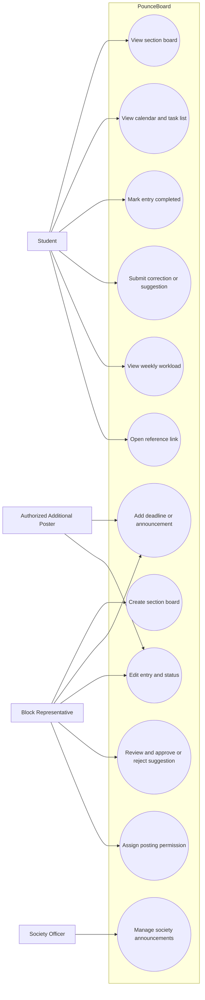

# Product Backlog

## Team Information

- Team name: RENEview ba?
- Project title: PounceBoard
- Primary user group for the first release: Students belonging to an MSU-IIT class section or block
- Format: User stories with one detailed use case and testable acceptance criteria

| Member | GitHub username | Personal CSC181 repository |
|---|---|---|
| Juniezsa Cassandra C. Bacus | fried.ShangHai| https://github.com/Juniezsa/CSC181.git |
| Sammy R. Ditanongun | slyoh26 | https://github.com/slyoh26/CSC181.git |
| Jeric I. Balos | JekoBot | https://github.com/JekoBot/CSC181.git |
| Amil H. Popawan | amillionaire | https://github.com/amillionaire/-CSC181 |

<!-- Add rows for all members. -->

**Completion note**: The interview log and proposal do not provide interview dates or the names of the team members who conducted each interview. These details are marked **To be supplied by the team** instead of being invented. The same applies to stakeholder validation that is not documented in the supplied files.

## 1. Interview Summary

The team gathered input from students, block representatives, and a student organization officer. The interviews show that students currently use several channels to receive announcements and maintain separate personal reminders. Block representatives act as intermediaries between instructors and students, and they sometimes need to repeat or correct information. The student organization officer described how announcements are distributed through Messenger, Facebook, and, for some CS announcements, Discord.

| Code | Stakeholder role | Date | Method | Interviewer(s) |
|---|---|---|---|---|
| V1 | Block representative, 3rd-year BA-FIL | Not stated | Written interview | To be supplied by the team |
| V2 | Student organization officer / vice mayor | Not stated | Written interview | To be supplied by the team |
| S1 | Student, 1st-year BS Biology (Microbiology) | Not stated | Written interview | To be supplied by the team |
| S2 | Student, 3rd-year BS Environmental Engineering | Not stated | Written interview | To be supplied by the team |
| S3 | Student, 4th-year BS ANBIO | Not stated | Written interview | To be supplied by the team |
| S4 | Student, 2nd-year BSEd Physics | Not stated | Written interview | To be supplied by the team |
| V3 | Block representative | Not stated | Written interview | To be supplied by the team |
| S5 | Senior CS student | Not stated | Written interview | To be supplied by the team |

**Interview coverage:** The log contains at least two stakeholder groups: students and block representatives. It also includes a student organization officer. Instructor announcements are discussed by interviewees, but the log does not contain a separately identified instructor interview. The team should not describe instructors as directly interviewed unless another interview record exists.

## 2. From Interview Notes to Needs

The findings below separate what interviewees said from the needs inferred by the team. The requirement ideas are proposed system behavior, not claims that the interviewees requested every exact feature.

| ID | Source | What we heard or saw | Underlying need | Requirement idea | Type |
|---|---|---|---|---|---|
| F1 | V1, V3 | Block representatives receive information from instructors through class discussions, group chats, Gchat, email, and MOLE, then relay it to their blockmates. | A section needs one shared place where information from different announcement channels can be collected. | The system shall let an authorized block representative create and publish a section announcement or deadline entry. | F |
| F2 | S1, S2, S3, S4, S5 | Students use different combinations of Google Classroom, MOLE, Gmail/Gchat, Messenger, university websites, and personal notes. Several students said they check more than one platform. | Students need a consolidated view so they do not have to switch between several platforms just to check upcoming requirements. | The system shall display deadlines and announcements from the section's subjects in one section board. | F |
| F3 | S1, S2, S3, S4 | Students use physical checklists, phone reminders, notes, notebooks, and calendars to remember deadlines. One student nearly missed a deadline after confusing this Friday with the following Friday. | Students need clear dates and a reliable way to review upcoming work. | Each entry shall display its title, subject, type, and due date and time, and shall be available in a calendar or task view. | F |
| F4 | V1, V3 | Representatives sometimes repeat announcements when students do not see them. Schedule changes and conflicting information can cause confusion. | Students need to recognize the latest version of an announcement and identify changes. | Authorized users shall be able to edit an entry and mark it as updated, extended, or pending clarification. | F |
| F5 | V1, V3 | Representatives want classmates to contribute additions or corrections, but they also want someone responsible for checking and confirming information. | Students need a way to report possible errors without allowing unverified information to become official. | Students shall be able to submit a suggested entry or correction, while an authorized representative approves or rejects it. | F |
| F6 | S1, S2, S3, S4 | Students prefer having information in one place. Most interviewed students said a consolidated view would make checking easier and reduce confusion. | Students need to find information quickly without searching several conversations or websites. | The system shall provide a section-level list of upcoming entries that can be reviewed together across subjects. | Q |
| F7 | V1, V3, V2 | Representatives and organization officers redistribute updated deadlines or announcements through existing group chats and rely on representatives to pass information along. | Users need updates to be easy to recognize and communicate, while retaining familiar communication channels. | The system shall show the updated entry and its status in the shared board; the prototype will not replace Messenger or provide its own chat. | F |
| F8 | V1, V3, V2 | Busy periods occur around midterms and finals. Interviewees described several requirements or events happening close together and the need to plan around conflicts. | Students and representatives need an overview of how demanding a week will be. | Each academic requirement shall have a workload weight, and the system shall show a weekly workload view based on the entries recorded. | F |
| F9 | V1, V3 | Representatives want to add the subject, activity, deadline, and reminders, and one representative described a quick-entry form with a title, subject, due date/time, and link. | Authorized users need to enter and update information without a lengthy process. | The system shall provide an entry form for title, subject, type, due date/time, workload weight, and optional details or link. | Q |
| F10 | V2 | The organization officer described using Messenger for small announcements and Facebook for announcements that need wider reach. Discord was also used for some CS-related announcements. | Organization-level announcements may need to reach members through a dedicated space while users retain their preferred communication channels. | The system may support a society or organization board in a later release, subject to a confirmed scope and access rules. | F |
| F11 | V2, S5 | The organization officer said students have different preferred communication channels. The senior CS student also preferred verification and said platform preference varies. | The system should complement existing channels instead of assuming every student will abandon them. | PounceBoard shall be a shared reference board and shall not require integration with or replacement of Messenger, Facebook, Discord, MOLE, or Google Classroom in the first release. | C |
| F12 | Proposal, V1, V3 | The proposal states that MOLE integration is outside the semester scope, and interviewees described information coming from several channels. | The first release must work even when information is entered manually. | Authorized users shall manually create and maintain entries; automatic MOLE or Google Classroom importing is excluded from Release 1. | C |

### Assumption log

These are assumptions or decisions that have not been confirmed by the interviews. They must not be presented as interview findings.

| ID | Assumption | Risk if wrong (High/Medium/Low) | How we will check it |
|---|---|---|---|
| A1 | Each section or block will have at least one representative willing and able to maintain its board. | High | Ask representatives from more than one section whether they can take responsibility for creating and updating entries during a prototype trial. |
| A2 | Students will regularly open a separate PounceBoard site or application if it makes cross-subject deadlines easier to review. | High | Run a short usability test with students and ask whether they would use the board alongside their existing channels. |
| A3 | A simple workload classification of Light, Medium, and Heavy will be understandable and useful to students. | Medium | Show sample weeks with different combinations of weights and ask testers to explain the workload indicator. |
| A4 | Representatives can verify student-submitted corrections before they are shown as official updates. | High | Walk through the proposed approval process with representatives and ask who should have approval rights. |
| A5 | The team can implement the core board, entry management, calendar/task view, and workload summary within the semester. | High | Estimate each story with the team, build a small technical prototype, and review progress at weekly checkpoints. |
| A6 | Society or organization boards can be added without making the first-release section board too complicated. | Medium | Keep society boards outside the MVP and revisit after the section workflow has been tested. |

## 3. User Stories

**Roles used:** A *student* is a member of a section board. A *block representative* is an authorized board manager. A *contributor* is a student allowed to submit a proposed entry or correction. An *organization officer* manages a society board only if that feature is included in a later release.

| ID | User story | Source finding(s) | Epic | INVEST check |
|---|---|---|---|---|
| US-01 | As a student, I want to view my section's shared board so that I can check upcoming requirements across my subjects in one place. | F2, F6 | Find section information | Draft passes most checks; depends on a board and membership data being available. |
| US-02 | As a block representative, I want to create a section board so that members of my block have a shared place for deadlines and announcements. | F1, F2 | Set up a section board | Draft passes most checks; confirm board setup is small enough for one sprint. |
| US-03 | As a block representative, I want to add an entry with its title, subject, type, due date and time, and workload weight so that students receive the important details of a requirement. | F1, F3, F8, F9 | Manage board entries | Draft passes most checks; confirm required fields and estimate with the team. |
| US-04 | As a student, I want to view entries in a calendar and task list so that I can understand what is due and when. | F2, F3, F6 | Review deadlines | Needs splitting or estimation: calendar and task-list views may be two implementation slices. |
| US-05 | As a student, I want to mark an entry as completed so that I can keep track of the requirements I have finished. | F3, F6 | Review deadlines | Draft passes most checks; confirm whether completion is personal or shared. |
| US-06 | As a block representative, I want to edit an entry and identify it as updated or extended so that students can distinguish the latest information from an earlier deadline. | F4, F7 | Maintain accurate information | Draft passes most checks; consider separating edit details from update labels if too large. |
| US-07 | As a student, I want to submit a correction or suggested entry so that information that may be missing or incorrect can be brought to the representative's attention. | F5 | Verify board information | Draft passes most checks; keep suggestion submission separate from approval. |
| US-08 | As a block representative, I want to approve or reject a submitted correction so that unverified information does not become an official board entry. | F5, F7 | Verify board information | Draft passes most checks; requires pending suggestions and representative permissions. |
| US-09 | As a student, I want to see a weekly workload overview based on the weight of upcoming requirements so that I can plan ahead for busy weeks. | F8 | Plan weekly workload | Fails Small in its current L estimate; split implementation before sprint planning. |
| US-10 | As a block representative, I want to assign another trusted member permission to post entries so that the board can still be updated when I am unavailable. | V1, F1, F9 | Manage board access | Draft passes most checks; verify that permission management is feasible in the project scope. |
| US-11 | As a student, I want to join a society board so that I can see announcements relevant to an organization I belong to. | F10, F11 | Society announcements | Not ready for estimation; later-release story with membership rules still to define. |
| US-12 | As a student, I want to open an entry's optional reference link so that I can go to the original instructions or submission page. | F1, F9 | Review deadlines | Draft passes most checks; small and independently testable once entries exist. |

> The INVEST column is marked **pending team review** because the source files do not show that the team has completed an INVEST review. The stories are drafted to be independent and testable, but the team must make the final confirmation.

### Epics and how we split them

| Epic | Split into | How we split it |
|---|---|---|
| Set up a section board | US-02, US-01 | Happy path first: create the board, then let students view it. |
| Manage board entries | US-03, US-06 | By workflow step: add an entry, then maintain it when details change. |
| Review deadlines | US-04, US-05, US-12 | By user action: view entries, track completion, and open a supporting link. |
| Verify board information | US-07, US-08 | By workflow step: submit a proposed change, then approve or reject it. |
| Plan weekly workload | US-09 | Kept as a focused story because it provides a distinct weekly planning outcome. |
| Manage board access | US-10 | By business rule: only an authorized representative can grant posting permission. |
| Society announcements | US-11 | Kept separate because it concerns a different board membership and may be delivered after the core section workflow. |

### Stories we rewrote

1. **Before:** As a student, I want an app that combines Google Calendar, Tasks, and Classroom so that I can manage everything.
   **After:** As a student, I want to view my section's shared board so that I can check upcoming requirements across my subjects in one place (US-01). Separate stories cover calendar/task viewing (US-04) and completion tracking (US-05).
   **Reason:** The original story combined several large features and did not identify a clear, independently testable outcome. It was too large and insufficiently independent.

2. **Before:** As a user, I want everyone to add and edit deadlines so that the board stays updated.
   **After:** Students submit proposed additions or corrections (US-07), and a block representative approves or rejects them (US-08).
   **Reason:** The original story did not define who could make an official change. The split makes the permission rule clear and reduces the risk of unverified information becoming official.

3. **Before:** As a block representative, I want to post announcements so that everyone knows what is happening.
   **After:** US-03 covers creating a structured deadline entry, while US-06 covers changing an existing entry and identifying its updated status.
   **Reason:** Adding information and correcting information are separate workflows with different acceptance conditions.


## Week 4 Lecture Alignment: INVEST and Backlog Quality Review

This section applies the definitions from the CSC181 Week 4 lecture. An INVEST review is not a declaration that a story is automatically correct. The team must read each story, discuss it, and confirm the result. The review below identifies likely strengths and issues to address before the backlog is finalized.

### INVEST criteria used

| Letter | Meaning from the lecture | Review question |
|---|---|---|
| I | Independent | Can the story be built in an order that does not force the team to finish another story first? |
| N | Negotiable | Are the details open to discussion with stakeholders, rather than treated as a fixed technical contract? |
| V | Valuable | Does the story deliver a benefit that a real stakeholder cares about? |
| E | Estimable | Does the team understand it well enough to give a rough size? |
| S | Small | Can it be completed in one sprint, ideally within a few days? |
| T | Testable | Can the team write clear acceptance criteria and verify the result? |

### Story-by-story INVEST review

| Story | I | N | V | E | S | T | Review and action |
|---|---|---|---|---|---|---|---|
| US-01 View section board | Conditional | Yes | Yes | Yes | Yes | Yes | Needs a board and membership data. Use a pre-created board as test data so the viewing story can be developed and tested independently of board creation. |
| US-02 Create section board | Yes | Yes | Yes | To confirm | To confirm | Yes | The goal is clear and valuable. Team must estimate board creation, section naming, and initial manager assignment. |
| US-03 Add entry | Conditional | Yes | Yes | To confirm | To confirm | Yes | Requires an existing board and posting permission. Use a pre-created board and account for validation. Estimate the form and save behavior before committing. |
| US-04 Calendar and task list | Conditional | Yes | Yes | To confirm | At risk | Yes | Two views may be too much for one small story. Implement the task list first, then the calendar as a separate story if the team agrees. |
| US-05 Mark completed | Conditional | Yes | Yes | Yes | Yes | Yes | Confirm whether completion is private to each student or visible to everyone. The current story should specify personal completion if that is the intended behavior. |
| US-06 Edit entry and status | Conditional | Yes | Yes | To confirm | At risk | Yes | Editing several fields and adding status labels may be larger than one small story. Keep only the highest-value editable fields in the first slice if needed. |
| US-07 Submit correction | Conditional | Yes | Yes | Yes | Yes | Yes | A clear, separate submission action. It can be tested using a pre-created board and does not include approval. |
| US-08 Approve or reject suggestion | Conditional | Yes | Yes | To confirm | Yes | Yes | Requires pending suggestions and representative permissions. Test using seeded pending suggestions. |
| US-09 Weekly workload | Conditional | Yes | Yes | At risk | No, currently L | Yes | This is the clearest INVEST issue. Split it into smaller implementation stories or tasks: list the selected week's entries, summarize the weights, and display the weekly indicator. Confirm the weighting formula with stakeholders. |
| US-10 Assign another poster | Conditional | Yes | Yes | To confirm | To confirm | Yes | Clear benefit, but permission rules need stakeholder agreement. Use a pre-existing section and member list for independent testing. |
| US-11 Join society board | Not yet | Yes | Yes | No | At risk | Yes | Society board membership rules and scope are not sufficiently defined. Keep it in Later / Won't this release until validated. |
| US-12 Open reference link | Conditional | Yes | Yes | Yes | Yes | Yes | A small user-visible outcome. It can be tested using an existing entry with a valid link and another with no link. |

**Important:** "Conditional" means the story has a dependency in the real product workflow. It does not automatically make the story invalid. The team can often preserve practical independence by using sample data, mocks, or an already-created board during implementation and testing.

### Suggested story refinements

**US-04 should be split if the team estimates it as too large:**

- US-04A: As a student, I want to view section entries in a task list, so that I can read the upcoming requirements in due-date order.
- US-04B: As a student, I want to view section entries on a calendar, so that I can see which dates have scheduled requirements.

These are proposed refinements. If adopted, replace US-04 with US-04A and US-04B throughout the backlog, acceptance criteria, story map, ordered backlog, and traceability table. Do not count both the parent and child stories as separate backlog items.

**US-05 should clarify whose completion status is being saved:**

- Recommended wording: "As a student, I want to mark an entry as completed for my own account, so that I can track the requirements I have finished without changing the status for my classmates."

This avoids the ambiguity between a personal checklist and a shared class status.

### Value versus effort review

The Week 4 lecture defines the four quadrants as follows:

| Quadrant | Meaning | How to use it |
|---|---|---|
| Quick Win | High value, low effort | Do early. |
| Big Bet | High value, high effort | Plan carefully and split into smaller slices. |
| Filler | Low value, low effort | Do only if capacity remains. |
| Time Sink | Low value, high effort | Avoid or defer. |

The quadrant labels in the ordered backlog are provisional team estimates, not facts from interviews. Reassess them after the team estimates effort and discusses user value. In particular, US-09 should not remain a single L-sized sprint commitment.

### EARS pattern check

The Week 4 lecture presents five EARS patterns. The current quality requirements use only some of them. The following additional examples show how the other patterns could be applied if they match the agreed project scope.

| Pattern | PounceBoard example |
|---|---|
| Ubiquitous | The system shall display all saved due dates and times using Philippine Time. |
| Event-driven | When an authorized representative approves a correction, the system shall update the corresponding board entry. |
| State-driven | While a student is viewing a section board, the system shall show only entries belonging to that section. |
| Unwanted behavior | If a user without posting permission attempts to publish an entry, then the system shall reject the action and leave the board unchanged. |
| Optional feature | Where an entry has a reference link, the system shall display a control that opens that link. |

### Acceptance criteria quality check

The Week 4 lecture distinguishes acceptance criteria from the Definition of Done:

- **Acceptance criteria** are specific to one story and state what that feature must do.
- **Definition of Done** applies to every story and states the team's shared quality bar.

For every story, acceptance criteria should describe observable outcomes, use concrete field names or conditions, and include at least one unhappy path. Avoid statements such as "works correctly," "easy to use," or "loads quickly" unless a measurable condition is defined.

### Product backlog readiness check

The Week 4 lecture describes a backlog as Detailed appropriately, Estimated, Emergent, and Prioritized. The current document is a draft backlog, not yet a verified GitHub project board.

Before Sprint 1:

1. Create one GitHub issue for each approved user story.
2. Put the story and its acceptance criteria in the issue body.
3. Add labels for story type, MoSCoW priority, epic, and size.
4. Assign each issue to the appropriate sprint milestone.
5. Order the project board from highest to lowest priority.
6. Keep Won't-have items recorded instead of deleting them.
7. Make sure the top stories are small, estimated, and ready to implement.

The Must-have set in this draft is six stories, but the lecture's 60% rule is based on **team capacity**, not the number of stories. The team must estimate the actual work and compare it with the capacity available across the two sprints. Until that is done, the backlog cannot honestly claim that the Must-haves fit within 60%.


## 4. Acceptance Criteria

The criteria below use observable outcomes. Each story has at least three criteria, including an unhappy path. Given–When–Then scenarios are included for every Must-have story in the ordered backlog.

### US-01: View the section board

**Acceptance criteria:**

- [ ] Given a student is a member of a section board, when the student opens the board, then the system displays the entries belonging to that section.
- [ ] Each displayed entry shows its title, subject, type, due date and time, and workload weight when those fields are present.
- [ ] (unhappy) Given a student is not a member of a section board, when the student attempts to open its restricted board, then the system denies access and displays an access message.

**Scenario 1: Member views the board**

```gherkin
Given a student is a member of the "BSCS-2A" section board
And the board contains "Calculus Quiz" for November 13, 2026 at 9:00 AM
When the student opens the "BSCS-2A" board
Then the system displays "Calculus Quiz" with its subject and due date
```

**Scenario 2: Non-member is blocked (unhappy)**

```gherkin
Given a student is not a member of the "BSCS-2A" section board
When the student attempts to open that board
Then the system denies access
And the system displays an access message
```

### US-02: Create a section board

**Acceptance criteria:**

- [ ] Given an authorized user has entered a valid section name, when the user submits the create-board form, then the system creates one board with that section name.
- [ ] The user who creates the board is recorded as its initial board manager.
- [ ] (unhappy) Given the section name is blank, when the user submits the form, then the system does not create a board and identifies the required field.

**Scenario 1: Valid board is created**

```gherkin
Given an authorized user is on the create-board page
When the user enters "BSCS-2A" as the section name and submits the form
Then the system creates the "BSCS-2A" board
And records the creator as its initial board manager
```

**Scenario 2: Required section name is missing (unhappy)**

```gherkin
Given an authorized user is on the create-board page
When the user submits the form without a section name
Then the system does not create a board
And displays a message that the section name is required
```

### US-03: View calendar and task list

**Acceptance criteria:**

- [ ] The student can switch between a calendar view and a task-list view of the same section entries.
- [ ] Entries in the calendar appear on their saved due dates, and task-list entries display their due date and time.
- [ ] (unhappy) Given the selected section has no entries for the displayed period, when the student opens the view, then the system displays an empty-state message instead of misleading or unrelated entries.

**Scenario 1: Student switches views**

```gherkin
Given the section board contains "Physics Report" due November 14, 2026
When the student opens the calendar view
Then "Physics Report" appears on November 14, 2026
When the student switches to the task-list view
Then "Physics Report" appears with the same due date
```

**Scenario 2: Selected period has no entries (unhappy)**

```gherkin
Given the selected week has no saved section entries
When the student opens the calendar view for that week
Then the system displays an empty-state message
And does not display entries from another section
```

### US-04: Mark an entry as completed

**Acceptance criteria:**

- [ ] Given an entry is not completed, when the student marks it as completed, then the interface displays its completed status.
- [ ] The completed status remains visible when the student changes between the calendar and task-list views.
- [ ] (unhappy) Given an entry cannot be found or is no longer available, when the student attempts to mark it complete, then the system displays an error and does not change another entry.

**Scenario 1: Student marks an entry as completed**

```gherkin
Given the "Physics Report" entry is not completed
When the student marks it as completed
Then the interface displays its completed status
And the completed status remains visible after the student switches
from the calendar view to the task-list view
```

**Scenario 2: Entry is no longer available (unhappy)**

```gherkin
Given the "Physics Report" entry has been removed from the board
When the student attempts to mark it as completed
Then the system displays an error
And does not change any other entry
```

### US-05: View weekly workload

**Acceptance criteria:**

- [ ] The weekly view groups section entries by their due dates within the selected week.
- [ ] The workload summary uses the saved Light, Medium, and Heavy weights of entries in that week.
- [ ] (unhappy) Given the selected week has no entries, when the student opens the workload view, then the system displays a no-upcoming-requirements message and does not label the week as busy.

**Scenario 1: Busy week is summarized**

```gherkin
Given the selected week contains one Light entry, one Medium entry,
and two Heavy entries
When the student opens the weekly workload view
Then the system lists the four entries under their due dates
And displays a workload summary based on their saved weights
```

**Scenario 2: Week has no entries (unhappy)**

```gherkin
Given the selected week contains no section entries
When the student opens the weekly workload view
Then the system displays a no-upcoming-requirements message
And does not mark the week as busy
```

### US-06: Assign another poster

**Acceptance criteria:**

- [ ] An authorized representative can select a member of the same section and grant that member posting permission.
- [ ] A member with posting permission can create and edit entries on that section board.
- [ ] (unhappy) A student without board-management permission cannot grant posting permission to another member.

**Scenario 1: Posting permission is granted**

```gherkin
Given an authorized representative is managing the "BSCS-2A" section board
And "Maria Santos" is a member of the "BSCS-2A" section
When the representative grants Maria posting permission
Then the system saves the permission
And Maria can create and edit entries on the "BSCS-2A" board
```

**Scenario 2: Student without management permission cannot grant access (unhappy)**

```gherkin
Given a student is a member of the "BSCS-2A" board without board-management permission
When the student attempts to grant "Maria Santos" posting permission
Then the system denies the action
And Maria's permissions remain unchanged
```

### US-07: Open an entry's reference link

**Acceptance criteria:**

- [ ] When an entry contains a valid reference link, the student can select it to open the linked resource.
- [ ] When an entry has no reference link, the system does not display a non-functional link control.
- [ ] (unhappy) When a saved reference link is malformed or cannot be opened, the system displays an error or unavailable-link message without changing the entry.

**SScenario 1: Valid link opens the resource**

```gherkin
Given the "Calculus Quiz" entry has a valid reference link
When the student selects the reference link
Then the system opens the linked resource
```

**Scenario 2: Saved link is malformed or unavailable (unhappy)**

```gherkin
Given the "Physics Report" entry has a malformed reference link
When the student selects the reference link
Then the system displays an unavailable-link message
And the entry remains unchanged
```

## 5. Quality Requirements and Constraints (EARS)

The interview log does not contain agreed numerical performance targets. Therefore, this section uses testable behavior without inventing response-time or availability figures. Any numerical target must be discussed with stakeholders and recorded later.

| ID | Requirement | EARS pattern | Type | Source | Number agreed with |
|---|---|---|---|---|---|
| NFR-01 | While a section board is displayed, the system shall show each entry’s due date and time identically in the calendar view and the task-list view. | State-driven | Quality(consistency) | F2, F3, F6 | N/A, proposed by team |
| NFR-02 | While a section board is displayed, the system shall show each entry’s due date and time identically in the calendar view and the task-list view. | Event-driven | Quality(performance) | F1, F4, F9 | N/A, proposed by team |
| NFR-03 | TThe system shall allow board creation, official entries, suggestion approval, and posting-permission grants only to users with board-manager permission.	 | Ubiquitous | Constraint / Security | F5, F7, F11 | N/A, proposed by team |
| NFR-04 | The system shall allow board creation, official entries, suggestion approval, and posting-permission grants only to users with board-manager permission. | Quality | F3, F9 | N/A, proposed by team |
| NFR-05 | The system shall not require automatic integration with MOLE, Google Classroom, Messenger, Facebook, or Discord in the first release | Ubiquitous | Constraint | F11, F12 | N/A, stated in proposal scope |

## 6. Use Case

### Use-case diagram



**Diagram note:** Society announcements (US-11) are a later-release capability. The diagram includes it to show the wider proposed system, not to imply that it belongs in the first-release MVP.

### UC-01: Add and publish a section deadline

| Field | Description |
|---|---|
| Primary actor | Block representative or authorized additional poster |
| Precondition | The actor is signed in, has posting permission, and has access to an existing section board. |
| Main success scenario | 1. The actor opens the section board. 2. The actor selects the option to add an entry. 3. The system displays the entry form. 4. The actor enters the title, subject, type, due date and time, workload weight, and any optional details or reference link. 5. The actor submits the form. 6. The system validates the required fields. 7. The system saves the entry to the selected section board. 8. The system displays the new entry in the board and relevant calendar, task-list, and workload views. |
| Extensions | **4a. Missing or invalid information:** The actor leaves a required field blank or enters an invalid date/time. The system identifies the field, does not save the entry, and returns the actor to the form. <br> **5a. Actor lacks permission:** The system rejects the attempt to publish and leaves the board unchanged. <br>**6a. Actor cancels:** The system discards the unsaved form and returns to the board. |
| Postcondition | A valid entry is saved to the selected board and is visible to its authorized members. No entry is created if validation or authorization fails. |
| Stories covered | US-03, US-01, US-04, US-09, US-12 |

## 7. Story Map

The journey follows the core workflow: access a section board, add or find requirements, review them, and plan the week. Release 1 is arranged as a complete path through all four journey steps.

| | 1. Access a section board | 2. Add and maintain entries | 3. Review requirements | 4. Plan the week |
|---|---|---|---|---|
| **Release 1 (MVP)** | US-02 Create a section board; US-01 View the board | US-03 Add an entry; US-06 Edit an entry | US-04 View calendar and task list; US-12 Open reference link | US-09 View weekly workload |
| **Release 2** | US-10 Assign another poster | US-07 Submit a correction; US-08 Approve or reject a suggestion | US-05 Mark an entry completed | Improve workload summaries after user testing |
| **Later** | US-11 Join a society board | Society officer manages society announcements | Browse announcements from joined societies | Consider additional planning features after validation |

**MVP note:** US-05 is useful, but the initial end-to-end path can work without completion tracking. It is therefore planned for Release 2. The first release focuses on creating and maintaining reliable shared entries, displaying them across subjects, and helping students identify busy weeks.

## 8. The Ordered Backlog

The table contains every user story exactly once. The order is a proposed team prioritization, with no tied ranks. Size estimates are relative: S means small, M means medium, and L means large.

| Rank | Story | MoSCoW | Size (S/M/L) | Value / effort quadrant | Sprint |
|---|---|---|---|---|---|
| 1 | US-02 Create a section board | Must | M | Big bet | Sprint 1 |
| 2 | US-03 Add a deadline or announcement entry | Must | M | Big bet | Sprint 1 |
| 3 | US-01 View the section board | Must | S | Quick win | Sprint 1 |
| 4 | US-04 View calendar and task list | Must | M | Big bet | Sprint 2 |
| 5 | US-06 Edit an entry and show its status | Must | M | Big bet | Sprint 2 |
| 6 | US-09 View weekly workload | Must | L | Big bet | Sprint 2, split before implementation |
| 7 | US-07 Submit a suggested entry or correction | Should | M | Big bet | Sprint 3 |
| 8 | US-08 Approve or reject a suggestion | Should | M | Big bet | Sprint 3 |
| 9 | US-05 Mark an entry as completed | Should | S | Quick win | Sprint 3 |
| 10 | US-10 Assign another poster | Could | M | Big bet | Later |
| 11 | US-12 Open an entry's reference link | Could | S | Quick win | Later |
| 12 | US-11 Join a society board | Won't this release | L | Money pit for this semester's scope | Not this time |

### How we ordered it

The first stories establish the section board and the ability to publish reliable entries, because the rest of PounceBoard depends on having a board and usable deadline data. Viewing the board is also essential because students are the primary users who need to find information across subjects. Calendar and task-list views, entry updates, and the weekly workload view follow because they turn the saved entries into useful planning information. Suggestion moderation is important for data accuracy, but it can follow the basic posting workflow; society boards are deferred because the proposal identifies the section board as the core semester project and the wider organization feature needs additional access rules.

### Capacity check

| Question | Answer |
|---|---|
| How many Must-have stories, and their total size? | 6 Must-have stories: 1 S, 4 M, and 1 L. The total is 1 S + 4 M + 1 L. |
| Do the Must-haves fit in about 60% of our time for two sprints? | **Not confirmed.** The proposal identifies limited time and developing team skills as constraints, but it does not provide sprint capacity or estimates in points/hours. The team should estimate the stories and split US-09 before committing. If the estimate exceeds roughly 60% of the two-sprint capacity, move a lower-value Must-have or reduce its first-release scope with stakeholder agreement. |
| Do the Release 1 stories form one complete path through the core workflow? | **Yes, as a proposed path:** create a board, add and update entries, view them across subjects, and review the weekly workload. |
| Are all L-sized Must-have stories split? | **Not yet.** US-09 is identified as L and must be decomposed into smaller implementation tasks before sprint commitment. The user story remains one user outcome in the backlog. |

**Suggested split for implementation of US-09:** (1) group entries by selected week, (2) count or summarize Light, Medium, and Heavy entries, and (3) display the weekly workload indicator. These are implementation tasks under US-09, not extra user stories.

## 9. Definition of Done

A story is considered done only when all applicable conditions are met.

- [ ] The implemented behavior matches the story and its acceptance criteria.
- [ ] The normal path and at least one relevant unhappy path have been tested.
- [ ] Required-field validation and permission checks work for the story.
- [ ] The feature displays the correct section's data and does not expose another section's restricted entries.
- [ ] The interface uses consistent names for subjects, entry types, dates, times, and workload weights.
- [ ] The feature has been reviewed by at least one other team member.
- [ ] Any discovered defect affecting the acceptance criteria has been fixed and retested.
- [ ] The code and any relevant documentation have been committed to the team's repository.
- [ ] The team can demonstrate the completed story using the project's demo data.

## 10. Traceability Table

This table includes every proposed Must-have story. Test case IDs are intentionally left blank for the Week 9 testing activity, as requested by the template.

| Story | Problem or goal it addresses | Source finding(s) | Test cases (Week 9) |
|---|---|---|---|
| US-02 | Give each class section a shared board for its information. | F1, F2 | |
| US-03 | Allow authorized users to record deadlines and announcements with consistent details. | F1, F3, F8, F9 | |
| US-01 | Let students check section requirements in one place. | F2, F6 | |
| US-04 | Let students review deadlines by calendar date or task list. | F2, F3, F6 | |
| US-06 | Keep deadline changes visible and distinguish updated information. | F4, F7 | |
| US-09 | Help students recognize busy weeks and plan ahead. | F8 | |

**Gaps found:** The interview log supports a need for consolidated announcements, deadline tracking, corrections, and workload planning. It does not directly confirm that students need society-board membership, personal completion tracking, or additional poster permissions. These remain proposal-based or inferred features and are therefore assigned lower priority or later releases. No automatic MOLE or Google Classroom integration is included because the proposal explicitly places it outside the semester scope.

## 11. Validation

### Team review

The following are proposed review findings based on checking the drafted backlog against INVEST and the template's quality checklist. The team should confirm that these problems were actually discussed during its review before presenting them as a completed meeting record.

| Problem found | Story or requirement | How we fixed it |
|---|---|---|
| The original idea of combining Calendar, Tasks, and Classroom was too broad and difficult to test as one story. | Initial broad tracker story; US-01, US-04, US-05 | Split the goal into viewing the shared board, switching views, and marking an entry completed. |
| Allowing every student to edit official entries could make incorrect information appear as confirmed. | Initial shared-edit idea; US-07, US-08 | Separated suggestion submission from representative approval or rejection. |
| The workload view could become too large to implement as one task. | US-09 | Kept the user outcome as one story but identified smaller implementation tasks and marked it for splitting before sprint commitment. |
| A story about posting announcements did not distinguish creating a new entry from correcting an existing one. | US-03, US-06 | Separated entry creation from editing and status updates, with separate acceptance criteria. |

### Stakeholder walk-through

**Status: Not yet documented in the supplied interview log or proposal.** The template requires the team to show the story map and top of the backlog to at least one interviewed stakeholder. Do not mark this activity as completed until the team has conducted it and recorded the actual feedback.

| Stakeholder | Date | What they said | What we changed |
|---|---|---|---|
| To be completed after the walk-through | To be supplied | Record the stakeholder's actual reaction to the story map and highest-priority stories. | Record only changes made in response to that feedback. |

## 12. Open Questions for Sprint 1

1. What exact fields should be required for every entry, and should the system support a separate submission location or reference link?
2. What rule should PounceBoard use to classify a week as Light, Moderate, or Heavy when entries have Light, Medium, and Heavy weights? The interviews support the need to see workload, but they do not establish a formula or threshold.
3. Who is allowed to create a section board, approve corrections, and grant posting permission, and how will the system confirm that a student belongs to the section?

## 13. Member Contribution Record

The proposal contains an initial contribution record. The table below carries those documented contributions forward and leaves backlog-specific work unassigned where the source files do not identify who performed it. Update this table to reflect the actual work completed by each member.

| Member | Interviews or analysis | Stories, criteria, or use case | Review or validation |
|---|---|---|---|
| Juniezsa Cassandra C. Bacus | Contributed two initial problem ideas, participated in selecting the project problem, expanded the concept to include a weekly calendar, and prepared the stakeholder list according to the proposal. | To be confirmed by the team. | To be confirmed by the team. |
| Sammy R. Ditanongun | Contributed app ideas, helped expand and select the study and assignment tracker, and worked on proposal constraints, scope, deliverables, assumptions, and success indicators. | To be confirmed by the team. | To be confirmed by the team. |
| Jeric I. Balos | Contributed two initial problem ideas and participated in comparing and selecting the project problem. | Prepared the proposed user and setting section and contributed proposed capabilities according to the proposal. Backlog-specific writing to be confirmed. | To be confirmed by the team. |
| Amil H. Popawan | Contributed two initial problem ideas for the proposal. | To be confirmed by the team. | To be confirmed by the team. |

## 14. References

- RENEview, *Team Brainstorming and Preliminary Project Proposal*, supplied project proposal.
- RENEview, *Interview Log*, supplied stakeholder interview notes.
- RENEview, *Product Backlog Template*, supplied assignment template.
- CSC181 Week 3 and Week 4 lecture slides are referenced by the assignment template, but the slide files were not included among the supplied materials. Add the exact slide titles or course reference details if required by the instructor.

## 15. Team AI Use Declaration

- [ ] No generative AI tools were used by any member in preparing this submission.
- [x] One or more members used generative AI tools. Details are provided below.

| Member who used AI | Tool | Purpose and sections assisted | How output was checked or revised |
|---|---|---|---|
| Sammy R. Ditanongun, as the submitting user of this ChatGPT session | ChatGPT | Helped organize the supplied interview log and project proposal into the product backlog, including findings, assumptions, user stories, acceptance criteria, use case, story map, prioritization, and draft validation sections. | The team must compare every finding against the original interview log and proposal, correct any inaccurate interpretation, confirm estimates and priorities, and replace all pending fields with actual team records. |

### Main prompts or interaction summary

The user asked ChatGPT to complete the product backlog template using the interview log and project proposal. ChatGPT used those supplied files to draft the sections and identify information that was not present in the sources. AI-generated suggestions in this document are not evidence of actual stakeholder interviews, stakeholder feedback, team meetings, or completed validation. The team remains responsible for checking and revising the document.

We acknowledge that AI-generated suggestions are not evidence of actual stakeholder interviews, feedback, or verified user needs. Every finding in Section 2 and every walk-through in Section 11 must come from a real person the team spoke to or observed. We remain responsible for the accuracy and explainability of this submission.

## 16. Team Confirmation

**Do not mark confirmation as complete until every member has reviewed and agreed to the same final file.**

| Member | Reviewed final version |
|---|---|
| Juniezsa Cassandra C. Bacus | To be confirmed |
| Sammy R. Ditanongun | To be confirmed |
| Jeric I. Balos | To be confirmed |
| Amil H. Popawan | To be confirmed |

## Submission Checklist

- [x] Interviews cover at least two stakeholder groups, with sources coded and no personal contact details included.
- [x] The needs table has at least 8 findings, each labelled F, Q, or C.
- [x] Assumptions are recorded separately from evidence.
- [x] There are 10 to 15 user stories, each with a real role, a "so that", and at least one finding.
- [x] Epics are split, and at least two rewrites are recorded.
- [x] Every story has at least 3 acceptance criteria, including an unhappy path.
- [x] Every proposed Must-have story has at least 2 Given–When–Then scenarios.
- [x] At least 3 quality requirements or constraints use EARS patterns.
- [x] One use case has a diagram, a main success scenario, and at least 2 extensions.
- [x] The story map has a Release 1 line that crosses every journey step.
- [x] Every story has a MoSCoW label and a size, and the backlog is in one order with no ties.
- [ ] Must-haves fit in about 60% of capacity. Team capacity and estimates still need confirmation.
- [x] Won't-have stories are kept in the backlog, not deleted.
- [x] A Definition of Done is included.
- [x] The traceability table covers every proposed Must-have story.
- [ ] The team review and stakeholder walk-through are recorded as completed. The walk-through still needs to be conducted and documented.
- [ ] Contributions, references, and AI use are declared. The draft declarations are present, but the team must verify them and add any required lecture-slide details.
- [ ] All members reviewed the same final document.
- [ ] Each member saved the file as `activities/product-backlog.md`, with any images in `activities/backlog-images/`.
- [ ] Each member committed and pushed their copy to their personal repository.
- [ ] Each member submitted their own GitHub file link through MOLE.

**Before submission:** Fill in the interview dates and interviewers if your team has those records, conduct and record the stakeholder walk-through, confirm the INVEST review and team contributions, estimate sprint capacity, and obtain all members' confirmation. The interview log does not provide enough information to fill these in honestly.
